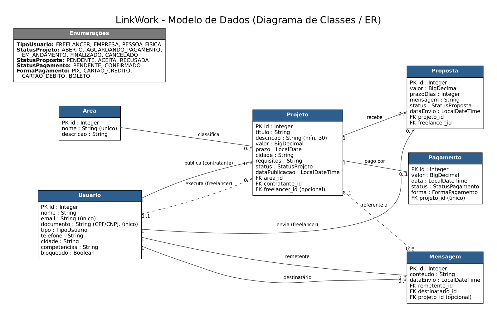

# LinkWork – Backend REST

**Projeto Integrador – Engenharia de Software (4º Termo)**
Disciplina: Padrões de Desenvolvimento Web – UNIFIO

## Descrição

O **LinkWork** é uma plataforma web que conecta freelancers a empresas e pessoas físicas que desejam contratar serviços. Contratantes publicam projetos, freelancers enviam propostas, as partes conversam pela plataforma e o pagamento é registrado antes do início do trabalho. Um painel acompanha os projetos ativos.

## Objetivo do backend

Disponibilizar uma API REST que implemente o fluxo principal do MVP descrito no ERS do LinkWork:

- cadastro de usuários com identificação única (RF01);
- publicação, edição e exclusão de projetos (RF02);
- busca e filtro de projetos por área, localização e valor, com análise de compatibilidade (RF03);
- comunicação entre usuários com histórico de conversas (RF04);
- gestão de pagamentos, com início do projeto condicionado à confirmação (RF05);
- painel de projetos ativos com status e prazos (RF06).

**Funcionalidade específica do PI:** fluxo de contratação – *proposta → aceite → pagamento → início → conclusão* (ver [ecommerce/docs/documentacao-api.md](ecommerce/docs/documentacao-api.md#10-funcionalidade-específica-do-pi--fluxo-de-contratação)).

## Tecnologias

- Java 17+
- Spring Boot 3.5 (Web, Data JPA, Validation, Security)
- Hibernate / JPA
- MySQL 8
- Lombok
- Maven
- Postman (testes da API)

## Arquitetura

```
src/main/java/br/edu/unifio/linkwork
├── entidades/       # Entidades JPA (Area, Usuario, Projeto, Proposta, Mensagem, Pagamento)
├── enums/           # TipoUsuario, StatusProjeto, StatusProposta, StatusPagamento, FormaPagamento
├── repositorios/    # Spring Data JPA (inclui consultas personalizadas)
├── servicos/        # Regras de negócio
├── recursos/        # Controllers REST (acessam somente os serviços)
├── dtos/            # Respostas específicas (compatibilidade, painel, total recebido)
├── excecoes/        # Exceções personalizadas + @RestControllerAdvice
└── configuracoes/   # Spring Security (HTTP Basic)
```

Fluxo: `Recurso (controller) → Serviço → Repositório → MySQL`.

## Modelo de dados



| Entidade | Relacionamentos |
|----------|-----------------|
| Area | 1 área → N projetos |
| Usuario | 1 contratante → N projetos; 1 freelancer → N projetos executados; 1 freelancer → N propostas; remetente/destinatário de N mensagens |
| Projeto | N:1 área, N:1 contratante, N:1 freelancer; 1 → N propostas; 1 → N mensagens; 1 → 0..1 pagamento |
| Proposta | N:1 projeto, N:1 freelancer |
| Mensagem | N:1 remetente, N:1 destinatário, N:1 projeto (opcional) |
| Pagamento | 1:1 projeto |

## Regras de negócio implementadas (camada Service)

| Regra | Onde | Resposta |
|-------|------|----------|
| RN01 – CPF (11) para freelancer/pessoa física, CNPJ (14) para empresa; documento único | `UsuarioServico` | 400 / 409 |
| RN02 – e-mail não pode ser duplicado | `UsuarioServico` | 409 |
| RN03 – projeto precisa de descrição mínima (30 caracteres) | `Projeto` (Bean Validation) | 400 |
| RN04 – edição só de projetos ABERTOS; exclusão só ABERTOS/CANCELADOS | `ProjetoServico` | 409 |
| RN05 – busca sem resultados retorna mensagem informativa | `ProjetoServico` | 404 |
| RN07 – análise de compatibilidade competências × requisitos | `ProjetoServico` | 200 |
| RN08 – usuário bloqueado não envia mensagens | `MensagemServico` | 409 |
| RN10 – projeto só inicia com pagamento confirmado | `ProjetoServico` | 409 |
| RN11 – pagamentos confirmados não podem ser excluídos | `PagamentoServico` | 409 |
| RN12 – projeto concluído é marcado como FINALIZADO | `ProjetoServico` | 200 |
| Área com projetos não pode ser excluída | `AreaServico` | 409 |
| Apenas freelancers enviam propostas, uma por projeto, só para projetos abertos | `PropostaServico` | 409 |
| Valor do pagamento deve ser igual ao da proposta aceita | `PagamentoServico` | 409 |

## Segurança

Autenticação **HTTP Basic** com usuários de teste em memória:

| Usuário | Senha | Perfil |
|---------|-------|--------|
| `admin` | `admin123` | ADMIN – acesso total |
| `usuario` | `usuario123` | USUARIO – sem exclusões, sem gestão de áreas e sem bloqueio de usuários |

- Sem credenciais / senha inválida → **401 Unauthorized**
- `usuario` executando `DELETE`, `POST /area` ou `PATCH /usuario/{id}/bloquear` → **403 Forbidden**

## Como executar

### Pré-requisitos

- JDK 17 ou superior
- MySQL 8 em execução na porta 3306
- Maven (ou o Maven embutido da IDE)

### Passos

1. Clone o repositório:
   ```bash
   git clone <url-do-repositorio>
   cd linkwork
   ```
2. Ajuste usuário e senha do MySQL em `src/main/resources/application.properties`:
   ```properties
   spring.datasource.username=root
   spring.datasource.password=root
   ```
   O banco `linkwork` é criado automaticamente.
3. Execute a aplicação:
   ```bash
   mvn spring-boot:run
   ```
   ou rode a classe `LinkworkApplication` pela IDE.
4. A API ficará disponível em `http://localhost:8080`.

> Com `spring.jpa.hibernate.ddl-auto=create`, as tabelas são recriadas e o `import.sql` é recarregado **a cada execução**, deixando o banco sempre no mesmo estado inicial.

### Testes automatizados

Com o MySQL em execução:

```bash
mvn test
```

## Testes com Postman

1. Importe `postman/projeto-integrador.postman_collection.json` no Postman.
2. As variáveis (`baseUrl`, usuários e senhas de teste) já estão na coleção.
3. **Reinicie a aplicação** e execute as pastas na ordem **00 → 07** (os ids usados dependem dos dados iniciais).
4. A descrição de cada requisição informa o status esperado.

Pastas: autenticação/autorização, CRUD de cada entidade, consultas personalizadas, regras de negócio, validações, recursos inexistentes e o fluxo completo de contratação.

## Documentação

- [Documentação dos endpoints](ecommerce/docs/documentacao-api.md)
- [Modelo de dados](ecommerce/docs/modelo-dados.png) (fonte Graphviz: `docs/modelo-dados.dot`)

## Integrantes

| Nome completo | ID acadêmico |
|---------------|--------------|
| Nicolas Rafael Domiciano Miguel | 272955 |
| Kauan Teixeira Poma |  |

